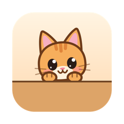
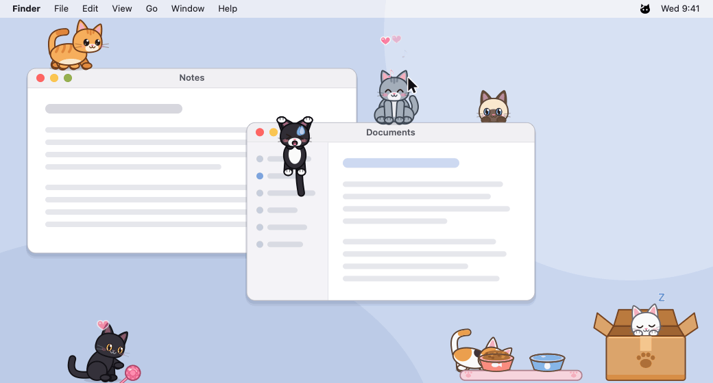
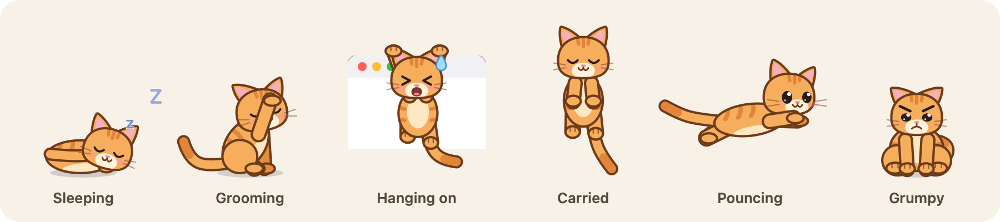
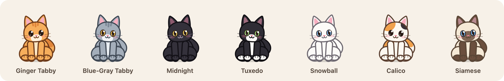

<p align="center"></p>

<h1 align="center">Mochi</h1>

<p align="center">A cat that lives on your desktop. She walks on your windows, hides behind them, naps on them,<br>slips off their edges, and expects to be fed.</p>

<p align="center"><a href="https://github.com/Mrkh97/mochi/releases/latest/download/Mochi.zip"><b>Download for macOS</b></a> · macOS 14 Sonoma or later · Apple silicon and Intel · or <a href="#homebrew">Homebrew</a><br><a href="https://github.com/Mrkh97/mochi/releases/latest/download/Mochi-Setup.exe"><b>Download for Windows</b></a> · Windows 10 and 11 · Intel/AMD and ARM</p>



Mochi lives in a cardboard box you can put anywhere on screen. She wakes up, hops out and treats your real windows as furniture. She has no Dock or taskbar button and never steals focus from the app you're using.

## Install on macOS

### Homebrew

```sh
brew install --cask mrkh97/tap/mochi-cat
```

Then open Mochi from your Applications folder and look for the cat face in the menu bar. `brew upgrade --cask mochi-cat` updates her. If you installed Mochi by hand before, add `--force` the first time so Homebrew can replace that copy.

The cask lives in [Mrkh97/homebrew-tap](https://github.com/Mrkh97/homebrew-tap). Because Mochi isn't notarized by Apple yet, the cask clears the quarantine flag macOS puts on downloads, so it opens without the warning described below.

### Download

1. Download [**Mochi.zip**](https://github.com/Mrkh97/mochi/releases/latest/download/Mochi.zip) from the [latest release](https://github.com/Mrkh97/mochi/releases/latest) and unzip it.
2. Drag **Mochi.app** into your **Applications** folder.
3. Open it. Mochi isn't notarized by Apple, so the first time macOS will say it can't verify the app. Close that message, then open **System Settings → Privacy & Security**, scroll down and click **Open Anyway** next to the message about Mochi.

   Or, in Terminal:

   ```sh
   xattr -dr com.apple.quarantine /Applications/Mochi.app
   open /Applications/Mochi.app
   ```

4. Look for the cat face in the menu bar. That's where all the settings are.

To start Mochi with your Mac, turn on **Open at Login** in its menu.

### Build from source

You need macOS 14 or later and Xcode or the Xcode command line tools (`xcode-select --install`).

```sh
git clone https://github.com/Mrkh97/mochi.git
cd mochi
./build.sh --install    # builds Mochi.app, copies it to /Applications and launches it
```

`./build.sh` alone just builds `build/Mochi.app`. `./build.sh --release` makes a universal (Apple silicon + Intel) build and zips it as `build/Mochi.zip`. Publishing a GitHub release with that `Mochi.zip` attached updates the Homebrew cask automatically (see `.github/workflows/homebrew.yml`).

### Optional: let the windows wobble

When a cat slips off a window, Mochi can physically jiggle that window. Moving other apps' windows needs the Accessibility permission:

1. Turn on **Slips Wobble Real Windows** in Mochi's menu.
2. Allow Mochi in **System Settings → Privacy & Security → Accessibility**.

Everything else works without it; the windows just stay put. If you rebuild or update the app, macOS may ask for the permission again.

### Uninstall

Quit Mochi from its menu and drag Mochi.app to the Trash. To also forget its settings: `defaults delete dev.mochi.desktopcat`.

If you installed with Homebrew: `brew uninstall --cask mochi-cat`, or `brew uninstall --cask --zap mochi-cat` to also forget her settings.

## Install on Windows

Mochi runs on Windows 10 and 11, on Intel/AMD (x64) and ARM PCs. One installer covers both; it picks the right build for your PC.

### Download

1. Download [**Mochi-Setup.exe**](https://github.com/Mrkh97/mochi/releases/latest/download/Mochi-Setup.exe) from the [latest release](https://github.com/Mrkh97/mochi/releases/latest) and open it.
2. Mochi isn't signed with a paid certificate, so Windows may say **Windows protected your PC**. Click **More info**, then **Run anyway**. (Your browser may also ask whether to keep the download.)
3. Click **Next**, then **Finish**. It installs just for you, so it doesn't ask for administrator rights. Leave **Start Mochi when I sign in** ticked to have her start with Windows (you can change this later with **Open at Login** in her menu).
4. Look for the cat face in the notification area at the right end of the taskbar. That's where all the settings are. Windows hides new icons under the **^** at first; drag it onto the taskbar to keep it in view.

To update, download and run the newest installer; it closes Mochi, keeps your cats and starts her again.

Everything works as on the Mac, with two differences:

- **Slips Wobble Real Windows** needs no permission on Windows. It can't move windows of apps running as administrator.
- Mochi sizes everything for your main display's scaling. On a second display with different scaling, cats look a little bigger or smaller there.

### Build from source

1. Install the tools. In PowerShell:

   ```powershell
   winget install --id Microsoft.VisualStudio.2022.BuildTools --exact --override "--passive --wait --add Microsoft.VisualStudio.Component.VC.Tools.x86.x64 --add Microsoft.VisualStudio.Component.VC.Tools.ARM64 --add Microsoft.VisualStudio.Component.Windows11SDK.26100"
   winget install --id Swift.Toolchain --exact
   winget install --id Git.Git --exact
   ```

   These are the Visual C++ build tools with a Windows SDK, the [Swift toolchain](https://www.swift.org/install/windows/) and Git.

2. Open a new PowerShell window (so it finds `swift` and `git`) and run:

   ```powershell
   git clone https://github.com/Mrkh97/mochi.git
   cd mochi
   powershell -ExecutionPolicy Bypass -File .\build.ps1 -Install
   ```

   This builds Mochi for your PC, copies it to `%LOCALAPPDATA%\Programs\Mochi` and starts it. Windows doesn't run downloaded scripts by default; `-ExecutionPolicy Bypass` allows just this one.

`build.ps1` puts its result in `build\Mochi-<arch>`: `Mochi.exe` plus the Swift and Visual C++ runtime DLLs it needs, so that folder runs on any PC of the same kind without installing anything. Its options (start each line with `powershell -ExecutionPolicy Bypass -File` as above if Windows won't run it):

```powershell
.\build.ps1                  # just build, for this PC
.\build.ps1 -Arch x64        # build for Intel/AMD PCs (works from an ARM PC too)
.\build.ps1 -Arch arm64      # build for ARM PCs (works from an Intel/AMD PC too)
.\build.ps1 -Release         # also zip it as build\Mochi-windows-<arch>.zip
.\build.ps1 -Installer       # build for both and make build\Mochi-Setup.exe
```

`-Installer` needs [Inno Setup](https://jrsoftware.org/isinfo.php) (`winget install --id JRSoftware.InnoSetup --exact`); the installer script is `windows\Mochi.iss`.

### Uninstall

Open **Settings → Apps → Installed apps**, find **Mochi** and choose **Uninstall**. That also removes its settings.

If you installed with `build.ps1 -Install` instead, turn off **Open at Login**, quit Mochi from its menu, and delete `%LOCALAPPDATA%\Programs\Mochi`. To also forget its settings, delete `%LOCALAPPDATA%\Mochi.exe.plist`.

## What she does

<p align="center"></p>

**Lives among your windows**
- **Walks on top of your windows** and rides along when you drag one.
- **Goes behind windows.** She sits *between* windows in the real stack, so whatever is in front hides her. She climbs up the back of a window and peeks over its top edge before pulling herself up, and sometimes sneaks behind the window she's sitting on.
- **Jumps** from window to window with a butt-wiggle first, and squashes on landing.
- **Slips and catches the edge.** She hangs by her front paws, legs kicking, sweating. Then she scrambles up and grooms as if nothing happened. Sometimes she falls instead and lands on her feet.

**Has a life of her own**
- **Sleeps** on windows, on the floor, or in her box with her chin on the rim, "z z z" floating up. She kneads before lying down, and stretches and yawns when she wakes.
- **Grooms** (paw-licking, face-washing), loafs, sits, gets the zoomies, and pounces on your pointer when it skitters along her ledge.
- **Slow-blinks** at you if you hover near her face.

**Likes you (mostly)**
- **Click to pet:** purring, hearts and happy eyes.
- **Drag to carry her** by the scruff. She dangles and swings. Let go (or fling her) and she falls onto whatever is below.

**Needs looking after**
- **Food and water.** A mat with a food bowl and a water bowl sits next to the box (drag it anywhere). Cats get hungry and thirsty, trot over and eat ("nom") or lap up water. **Click a bowl to refill it**, or use *Refill Food & Water* (⌘F). An empty bowl shows a bobbing red "!" and the menu bar icon gets a red dot.
- **Grumpiness.** A hungry cat that finds its bowl empty sits by it yelling "mew!", then "MEOW!!". Leave it long enough and it gets properly grumpy: furrowed brows, flat ears, a lashing tail, sulking with its back to you, hissing at your pointer, swatting your hand when you try to pet it. Fill the bowls and it eats and forgives you. A few pets help too.

**Plays**
- **The yarn ball.** Drag it around or fling it. It bounces, rolls along windows and falls off edges. Cats stalk it, wiggle and pounce, and can catch it right out of your hand. Then they bunny-kick it and bat it about before letting it roll away. Click the ball while a cat has it to snatch it back.

**Has friends**

Adopt up to six cats. Together they:
- touch noses (hearts!)
- groom each other's heads
- chase each other across the floor or a window top
- wrestle in a cartoon dust cloud, then pop out and groom as if nothing happened
- snuggle up for a nap next to a sleeping friend, purring
- tackle whoever has the yarn ball to steal it

A grumpy cat hisses at a friend who comes too close.

**Roams across displays**

With more than one display, cats wander between screens that touch, and tend to follow you to the one you're working on:
- **side by side:** they stroll across the border, or hop up or down if the floors are at different heights
- **a screen above:** they climb up the back of a tall window, peek over the top, and jump up from there
- **a screen below:** they peer over the bottom edge, wiggle, and drop through
- **screens that don't touch:** they wander off the edge and stroll in from the side of the other screen

The box and bowls can live on any screen, and hungry or sleepy cats find their way back.

### Seven coats

<p align="center"></p>

There are also four sizes and three energy levels.

## The menu

Click the cat face in the menu bar (on Windows, in the notification area), or right-click a cat, to see how each cat is doing and how full the bowls are. From there you can:

| | |
|---|---|
| **Refill Food & Water** | Top up both bowls (⌘F on a Mac) |
| **Get the Yarn Ball Out / Put It Away** | Show or hide the toy |
| **Call Home / Nap Time / Wake Up!** | Send everyone to the box, to sleep, or out to play |
| **Coat, Size, Energy** | Per-cat coat; size and activity for everyone |
| **Adopt Another Cat** | Up to six |
| **Rehome a Cat** | Pick which one goes. Right-clicking a cat also offers *Rehome* for just that cat |
| **Box Stays Above Windows** | Keep the box and bowls on top, or down on the desktop |
| **Move Box to Pointer** | Or just drag the box. It stays where you put it |
| **Slips Wobble Real Windows** | See [the permission above](#optional-let-the-windows-wobble) (none needed on Windows) |
| **Open at Login, Hide Cats, Quit** | |

## How it works

Mochi is one Swift app with no dependencies. Every cat, the box, the bowls and the yarn ball are small transparent windows. The cats are drawn with vector shapes from a pose that is blended every frame, so every movement is smooth.

Almost all of it is shared between macOS and Windows and lives in `Sources/Mochi`. It reaches the operating system only through the `Platform` protocol (`Platform.swift`): the window list, screens, the pointer, transparent windows to draw in, text and menus. `Sources/Mochi/Mac` implements that with AppKit; `Sources/Mochi/Windows` with Win32 layered windows, Direct2D and DirectWrite (through the small C++ shim in `Sources/CDirect2D`), plus a stand-in for the part of CoreGraphics the drawing code uses, so the cats are drawn by exactly the same code on both.

| Piece | File |
|---|---|
| The running app: cats, box, bowls, toy, frame loop, settings, the menu | `Household.swift` |
| Window list, screens, surfaces a cat can stand on, who covers what | `World.swift` |
| Placing a cat's window *between* other apps' windows (ordered relative to their window numbers or handles) | `Cat.swift` (`applyDepth`, `verifyStack`, `reanchor`) |
| Deciding what to do and planning jumps, climbs, hops and naps | `CatBrain.swift` |
| Activities: idle, walk, groom, sleep, pet, box | `Actions.swift` |
| Motion: jump, fall, climb, slip, carried | `Actions+Motion.swift` |
| The cat herself: vector drawing from a blendable pose | `Pose.swift`, `CatRenderer*.swift`, `Coat.swift` |
| Wobbling real windows (the Accessibility API on macOS) | `Mac/MacNudger.swift`, `Windows/WinPlatform.swift` |
| The cardboard box (two windows, so a cat can sit *inside* it) | `HomeBox.swift` |
| Food & water, hunger, thirst and grumpiness | `Bowls.swift`, `Needs.swift` |
| The yarn ball (physics) and chasing, pouncing and playing with it | `Toy.swift`, `ToyActions.swift` |
| Cats together (boops, grooming, chase, wrestling) | `Social.swift` |
| Travelling between displays | `Travel.swift` |

**Depth model:** every cat is either behind all windows, directly above one specific window, in front of everything (while carried or playing), in her box, or at the bowls. A falling cat passes behind anything in front of her and only lands on edges she can actually see. She only changes depth where nothing covers her, so she never visibly pops through a window.

### Developer flags

```sh
.build/release/Mochi --sheet poses.png [coat]   # render every pose to a PNG
.build/release/Mochi --icon icon.png            # render the app icon
.build/release/Mochi --showcase docs            # paint the README pictures (docs/make-visuals.sh does the rest)
.build/release/Mochi --bench                    # renderer timing
MOCHI_DEBUG=1 .build/release/Mochi              # log every activity + timings
MOCHI_TEST=1  .build/release/Mochi              # explore, slip and socialise much more often
MOCHI_FAST_NEEDS=1                              # hunger and thirst 25x faster
MOCHI_EMPTY=1 MOCHI_REFILL_AFTER=70             # start with empty bowls, refill after 70 s
MOCHI_TOSS=1                                    # the yarn ball throws itself around
MOCHI_TRAVEL=1                                  # cats hop between displays constantly
```

Running the bare binary (`.build/release/Mochi`) keeps its settings separate from the installed app, so you can test without disturbing your own cats.

On Windows, `Mochi.exe --sheet` and `--bench` work the same, and with `MOCHI_DEBUG` set the log goes to `%TEMP%\mochi-debug.log` (a windowed app has no console).

## Similar projects

Other desktop pets for the Mac (checked October 2026). As far as I know, none of them go *between* windows or wobble them:
[Peekoo](https://peekoo.app) (climbs windows, always on top, paid),
[Loafstead](https://slowchop.itch.io/loafstead) (cats sleep on windows, early access),
[Dockitty](https://apps.apple.com/app/dockitty/id6743999434),
[CATAI](https://github.com/wil-pe/CATAI),
[neko](https://github.com/superbereza/neko),
[Shijima-Qt](https://github.com/pixelomer/Shijima-Qt) (Shimeji; development paused).
